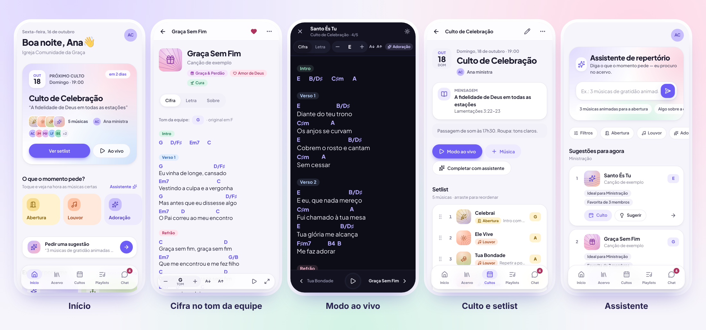
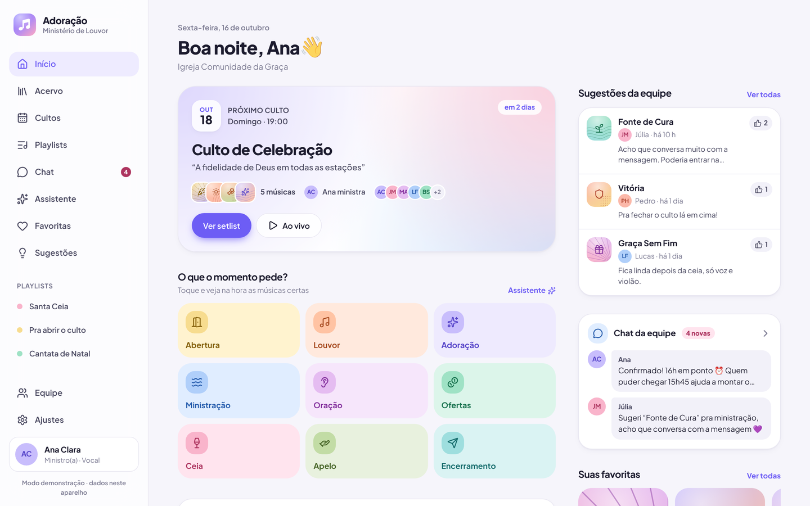

# Adoração · app do ministério de louvor

Repertório organizado por **tema, significado e momento do culto**, **cadastro pelo nome da música** (o app acha a gravação certa e preenche a ficha), **cifras** que mudam de tom na hora, **letras** para os cantores, **player** e **gravações de ensaio**, **programação** com setlist, escala e presença, **votação das músicas**, painel **“Para você”** com lembretes e avisos personalizados, **sugestões**, **playlists** e **chat** da equipe — num app leve, bonito e que funciona até sem internet.

**No ar:** [appadoracao.vercel.app](https://appadoracao.vercel.app) · cada envio para o ramo principal publica uma nova versão automaticamente.



---

## O que o app faz

**Escolher a música certa, rápido**
- **Escolha rápida por momento**: toque em *Abertura*, *Louvor*, *Adoração*, *Ministração*, *Ceia*, *Ofertas*, *Apelo*… e veja na hora as músicas que funcionam ali.
- **Assistente de repertório**: entende pedidos como *“3 músicas de gratidão animadas para a abertura”* ou *“algo sobre a cruz para a ceia”*. Explica o porquê de cada sugestão: momento, tema, ritmo, **tom que emenda com a música anterior**, se a equipe já conhece e se foi tocada recentemente.
- **Setlist automático**: monta abertura → louvor → adoração → ministração a partir do tema da pregação, encadeando os tons.
- **Músicas organizadas** por 35 temas em grupos (Quem Deus é, Obra de Cristo, Nossa resposta, Vida com Deus, Espírito & Igreja, Datas) — de *Adoração* e *Cruz & Sangue* a temas bem específicos como *Fidelidade de Deus*, *Nome de Jesus*, *Arrependimento*, *Refúgio & Proteção*, *Família*, *Volta de Jesus* e *Recomeço* — mais os **temas criados pela própria equipe** (com cor, ícone e palavras que o app reconhece nas letras). Também 11 momentos do culto, ritmo, tom, etiquetas, significado e referências bíblicas. Busca sem acento por título, artista, **trecho da letra** ou referência (“sl 23” acha Salmos 23).

**Cadastro pelo nome (o jeito principal de cadastrar)**
1. **Digite a música e o artista** (ex.: *galileu fernandinho*): aparecem os **vídeos do YouTube**, com o nome certo da música e do artista (mesmo quando o vídeo vem como "Música - Artista"), versão (*Ao Vivo*, *Playback*…) e duração. O catálogo do Deezer só entra no lugar se o YouTube não responder.
2. **Toque na imagem** para **ouvir um trecho de 30 segundos** ali mesmo, sem abrir o vídeo, e confirmar que é a música certa.
3. **Toque no vídeo certo** e o app monta a ficha sozinho, com esse vídeo guardado na música: capa, **tom original e BPM**, ritmo, **temas e momentos do culto** e um rascunho do **significado**, tirados da própria cifra e do catálogo. Com a chave da IA (opcional, paga) o app também pesquisa na web: Spotify, compasso, **significado**, **referências bíblicas** e, quando alguma página descreve a gravação, **notas de arranjo** (como começa, quando a banda entra, o que repete, como termina), sempre com as fontes consultadas. O que nenhuma fonte confirma fica em branco.
4. **Cifra e letra entram sozinhas**: o app acha a página da música pela busca do próprio Cifra Club e importa o texto com cada acorde em cima da sílaba certa, mostrando a fonte. Se o site demorar, toque em **Buscar de novo**.
5. Confira e salve. Tudo continua editável, e o **BPM no toque** fica à mão para ajustar o andamento.
- Também dá para **colar um link** do YouTube/Spotify, cadastrar **vários links de uma vez** (a cifra de cada uma entra sozinha; as que não forem encontradas ficam com a etiqueta *sem-cifra*) ou **preencher à mão**.

> Letras e cifras têm direitos autorais: o app importa o texto já publicado na página citada (nunca o inventa) e mostra a fonte. A responsabilidade de ter licença para reproduzir o conteúdo — ex.: CCLI — é do ministério, a mesma que vale para o texto colado à mão.

**Cifras e letras**
- Transposição instantânea com a grafia correta (B♭ em Fá, A♯ em Mi; diminutos de passagem com ♯).
- **Tom da equipe** (o “nosso tom”), **tom pessoal** de cada membro e **tom do culto** em cada setlist.
- Capotraste com sugestão de forma fácil (“casa 3, forma de G”).
- Visão **Letra** limpa e grande para quem canta (abre direto nela para quem é vocal).
- Tamanho da fonte, rolagem automática, metrônomo e tela sempre ligada.
- **Modo ao vivo**: tela cheia e escura, uma música por vez, passa com gesto, setas do teclado ou **pedal Bluetooth**.
- **Buscar cifra** no editor da música: traz a cifra e a letra de novo, quando a música ainda não tem acordes. O app **detecta o tom** pelos acordes e sugere temas e momentos pela letra.

**Ouvir e ensaiar**
- **Player dentro do app**: o vídeo do YouTube ou a faixa do Spotify tocam na própria página da música — dá para ouvir com a cifra aberta.
- **Gravações de ensaio**: grave pelo microfone do celular ou envie um áudio/vídeo (MP3, M4A, WAV…), ligado ao culto e/ou à música. O **player fixo** continua tocando enquanto você navega, com velocidade mais lenta para estudar (0,75×), repetição e avanço de 10 s. Tela **Ensaios** com tudo organizado por culto.

**Presença**
- Cada membro **confirma** que vai ou **avisa a ausência com justificativa** (trabalho, saúde, viagem, família, estudos ou outro motivo + texto).
- No dia, o líder (ou quem ministra) marca **presente/ausente** — com “todos presentes” em um toque.
- Tela **Presença**: ausências avisadas para os próximos cultos, **frequência** de cada membro (30/90 dias ou tudo) e histórico com as justificativas.

**Votação das músicas (como a enquete do WhatsApp, só que organizada)**
- O líder escolhe em **Equipe → Escolha das músicas**: *Líder escolhe* ou *Votação semanal*.
- Na votação semanal, **toda quinta às 12h** abre a votação do culto e ela **fecha no sábado às 12h**, a tempo do ensaio da quinta seguinte (para o culto do domingo depois do ensaio). Cada membro vota entre as **sugestões** da equipe, em até tantas músicas quantas o líder definir (de 1 a 20).
- Ao fechar, as mais votadas **entram sozinhas no setlist** (empate: vale a sugestão mais antiga). O líder pode abrir antes, **encerrar na hora** (as vencedoras vão direto para o setlist), mudar a quantidade de músicas ou escolher direto num evento específico.

**Para você — o painel de cada membro**
- No topo do início (e no 🔔 em qualquer tela), cada pessoa vê lembretes **só seus, chamando pelo nome**: que está na escala (com botão para confirmar presença), o ensaio da semana, a votação aberta (com contagem regressiva), um convite para sugerir música, o resultado da votação, faltas sem justificativa, **parabéns pela frequência alta** ou um carinho quando a frequência cai — com anéis de progresso, capas, avatares e animações.
- O contador do 🔔 mostra só o que é novo e **zera ao abrir**. Cada um **exclui** as notificações que quiser (uma a uma ou *Limpar tudo*) e pode trazê-las de volta; isso vale em todos os aparelhos da pessoa.
- **Notificações no celular** (as que aparecem na tela de bloqueio): quando a pessoa entra na **escala**, quando a **votação** abre e nas últimas horas (só para quem não votou), quando o **setlist** fica pronto ou muda, no **dia do ensaio** e quando o líder publica um **aviso**. Chamam pelo nome, abrem a página certa ao tocar e, no Android, vêm com uma arte de cada tipo. Cada membro escolhe o que quer receber em **Perfil → Notificações no celular** (com botão de teste); entre 22h e 7h nada toca — chega às 7h. No iPhone funcionam com o app instalado na tela de início (iOS 16.4 ou mais novo).
- O líder vê também as pendências dele (quem não confirmou, quem avisou ausência na escala, setlist vazio, sugestões esperando) e **publica avisos** para a equipe toda, para funções (ex.: só as vozes) ou para pessoas específicas.

**Equipe**
- Contas individuais com e-mail e senha, liberadas por **código de convite**, com **foto de perfil**.
- **Programação** com cultos, festas, congressos e eventos especiais (apresentações) e também ensaios e reuniões. O **próximo evento** do início considera só as apresentações.
- Setlist (arraste para reordenar), observações por música, alerta de saltos de tom e **escala** (quem ministra, canta e toca).
- **Só o líder coloca músicas no culto.** Os membros usam **Sugerir** (em cada música e em cada evento): a sugestão vai para a votação ou para o líder aceitar.
- **Favoritas** e **playlists** (só suas ou compartilhadas com a equipe).
- **Chat** em tempo real com reações e compartilhamento de músicas e cultos.

**Por baixo**
- Instala no celular como app (PWA) e **funciona offline**: alterações feitas sem internet são enviadas quando a conexão volta.
- Tema claro e escuro, layout para celular, tablet e computador.



---

## Experimentar agora (modo demonstração)

Precisa de [Node.js 20+](https://nodejs.org).

```bash
npm install
npm run dev
```

Abra http://localhost:5173 e escolha um dos 8 membros de exemplo. Nesse modo os dados ficam **só no seu navegador** — ótimo para conhecer o app. Abra duas abas como membros diferentes para ver o chat em tempo real.

---

## Colocar no ar para a equipe (gratuito, ~15 minutos)

O app usa o [Supabase](https://supabase.com) (banco, login e tempo real — o plano gratuito sobra para uma equipe) e pode ser publicado na [Vercel](https://vercel.com) ou na [Netlify](https://netlify.com).

### 1. Criar o banco no Supabase
1. Crie uma conta em supabase.com → **New project** (região *South America (São Paulo)*).
2. Abra **SQL Editor → New query**, cole o conteúdo de [`supabase/migrations/20261016000000_init.sql`](supabase/migrations/20261016000000_init.sql) e clique em **Run**. Depois, numa nova query, faça o mesmo com [`supabase/migrations/20261017000000_v2_midia_presenca.sql`](supabase/migrations/20261017000000_v2_midia_presenca.sql) (fotos, capas, Spotify, presença, gravações e temas da equipe — também cria o espaço privado `ensaios` para os áudios) depois com [`supabase/migrations/20261018000000_v3_votacao_avisos.sql`](supabase/migrations/20261018000000_v3_votacao_avisos.sql) (tipos de evento, votação, avisos do líder e a regra de que só o líder mexe no setlist) depois com [`supabase/migrations/20261019000000_v4_seguranca.sql`](supabase/migrations/20261019000000_v4_seguranca.sql) (ajustes pedidos pelo *Security Advisor* do Supabase) e, por último, com [`supabase/migrations/20261020000000_v5_perfil_votacao_avisos.sql`](supabase/migrations/20261020000000_v5_perfil_votacao_avisos.sql) (salvar o próprio perfil, votação com qualquer número de músicas, encerrar na hora e notificações excluídas). Para as notificações no celular, rode também [`…_v6_notificacoes.sql`](supabase/migrations/20261021000000_v6_notificacoes.sql) e [`…_v6_agendador.sql`](supabase/migrations/20261021000100_v6_agendador.sql) (veja *Notificações no celular* abaixo).
3. Em **Project Settings → API Keys**, copie a **Project URL** e a chave **publishable** (`sb_publishable_…`). Ela é pública: pode ir para o navegador sem problema, quem protege os dados são as regras do banco. (A chave *anon* antiga também funciona, mas o Supabase vai desligá-la no fim de 2026.)
4. Em **Authentication → URL Configuration**, coloque em **Site URL** o endereço onde o app vai ficar (ex.: `https://adoracao-da-igreja.vercel.app`).
5. Em **Authentication → Sign In / Providers → Email**, desligue *Confirm email*. Sem um servidor de e-mail próprio (SMTP), o Supabase só entrega e-mails para quem é da organização no painel do Supabase, então a confirmação não chegaria aos membros. O código de convite continua protegendo o cadastro. Se um dia quiser confirmação de e-mail e "esqueci minha senha" funcionando para todos, configure um SMTP (ex.: [Resend](https://resend.com/docs/send-with-supabase-smtp), que tem plano gratuito) em **Authentication → Emails → SMTP Settings**.

> Projetos gratuitos do Supabase entram em pausa depois de uma semana sem uso. Com o ministério usando toda semana isso não acontece; se acontecer, é só clicar em *Restore* no painel.

> **Já tinha o app no ar?** Rode no SQL Editor só os arquivos que ainda não rodou (`…_v2_midia_presenca.sql`, `…_v3_votacao_avisos.sql`, `…_v4_seguranca.sql`, `…_v5_perfil_votacao_avisos.sql` e/ou os dois `…_v6_…`). Até lá o app continua funcionando, mas sem as funções novas.

### 2. Publicar o app
**Vercel**: *Add New → Project* → importe este repositório → em *Environment Variables* adicione:

```
VITE_SUPABASE_URL=https://SEU-PROJETO.supabase.co
VITE_SUPABASE_ANON_KEY=sb_publishable_...
```

→ **Deploy**. (Na Netlify é igual: o arquivo `netlify.toml` já está pronto.)

> Este repositório já traz em [`.env.production`](.env.production) o endereço e a chave pública do banco da nossa equipe, então na Vercel basta importar e clicar em **Deploy**. Para usar outro projeto do Supabase, troque os valores nesse arquivo ou defina as variáveis no painel (elas têm prioridade).

Para rodar no seu computador conectado ao banco, copie `.env.example` para `.env.local` e preencha as mesmas variáveis. (`npm run dev` continua em modo demonstração sem o `.env.local`; `npm run build` usa o `.env.production`.)

### Busca pelo nome, cifra e ficha automática (função do servidor; chave da IA opcional)
A função `importar-musica` faz a busca pelo nome, traz os dados dos links, importa a cifra e monta a ficha. **Sem a chave da IA, tudo isso funciona de graça**: busca no YouTube com prévia de 30 s, nome certo da música, cifra e letra, capa, BPM do catálogo, tom pela cifra e temas e momentos pela letra. **A chave da IA ([DeepSeek](https://platform.deepseek.com)) é opcional e paga**: com ela, o app também pesquisa a música na web e escreve o significado e as referências bíblicas, e acha o Spotify, o BPM e o compasso da gravação.

- **Nada é inventado**: dado da gravação (Spotify, tom, BPM, compasso, arranjo) só entra se veio de uma página encontrada na busca, que aparece em *Fontes consultadas*. **Notas de arranjo** só quando uma fonte descreve como a gravação é tocada; sem isso, o campo fica vazio (o app não sugere arranjo). Referências bíblicas com livro ou capítulo que não existem ficam de fora.
- O tom que vale é o da cifra importada (é nele que a equipe toca).

1. Crie a conta em [platform.deepseek.com](https://platform.deepseek.com), coloque crédito em *Top up* (o uso é descontado do saldo) e crie a chave em *API Keys*.
2. No painel do Supabase: **Edge Functions → Secrets → Add new secret**, nome `DEEPSEEK_API_KEY`, valor = a chave.

**Custo**: só com a chave, e só quando alguém cadastra uma música pelo nome — cerca de US$ 0,01 por música (4 ou 5 buscas na web a US$ 0,75 por mil, mais o modelo `deepseek-flash` com o modo de raciocínio desligado, o jeito mais barato de usar a DeepSeek; ele custa metade fora do horário de pico; no Brasil o pico cai de madrugada). Sem saldo, o app avisa e continua com a ficha gratuita. Os dados enviados (nome, artista e letra da música) são processados pela DeepSeek, em servidores na China.

Para publicar a função num projeto novo, com a [CLI do Supabase](https://supabase.com/docs/guides/cli) instalada:

```bash
supabase login
supabase link --project-ref SEU-PROJETO
supabase functions deploy importar-musica --no-verify-jwt   # a própria função confere o login
supabase secrets set DEEPSEEK_API_KEY=sk-...
```

A função está em [`supabase/functions/importar-musica`](supabase/functions/importar-musica/index.ts) e só atende membros logados. A página da cifra vem da busca do próprio Cifra Club (o endereço não dá para adivinhar: *Grande é o Senhor* fica em `grande-o-senhor` num artista e em `grande--o-senhor` em outro), e o texto é lido do bloco da cifra com os espaços intactos, então cada acorde fica em cima da sílaba certa. Para conferir o que está ligado no servidor: `{ "action": "status" }` devolve se há chave da IA e do YouTube (sem mostrar as chaves).

#### Busca no YouTube (chave gratuita do Google)
A busca pelo nome procura primeiro no YouTube, pela API oficial. Sem a chave, ela usa o catálogo do [Deezer](https://developers.deezer.com) — o resto funciona igual.

1. Em [console.cloud.google.com](https://console.cloud.google.com), crie um projeto (ex.: *Adoração*).
2. **APIs e serviços → Biblioteca** → procure **YouTube Data API v3** → **Ativar**.
3. **APIs e serviços → Credenciais → Criar credenciais → Chave de API**. Em **Restringir chave**, marque só a *YouTube Data API v3*.
4. No painel do Supabase: **Edge Functions → Secrets → Add new secret**, nome `YOUTUBE_API_KEY`, valor = a chave.

**Custo**: nenhum, não precisa de cartão. A cota gratuita dá cerca de **100 buscas por dia** para a equipe toda (o app só busca quando a pessoa para de digitar e não repete uma busca já feita). Se a cota do dia acabar, a busca passa sozinha para o Deezer até o dia seguinte.

#### Testar antes de publicar
O branch de produção da Vercel publica direto no app oficial. Para testar uma mudança antes, publique num branch separado: a Vercel gera um **link de pré-visualização** com o app completo, ligado ao mesmo banco. Nesse link a importação usa a cópia `importar-musica-teste` da função (variável `VITE_IMPORT_FUNCTION`, definida na Vercel só para pré-visualizações), então a função oficial só muda depois de aprovada:

```bash
supabase functions deploy importar-musica-teste --no-verify-jwt   # a cópia, com o código novo
```

Como o banco é o mesmo, o que for salvo no teste (músicas, cultos…) aparece no app oficial.

### Notificações no celular
1. Publique a função: `supabase functions deploy notificar --no-verify-jwt`.
2. Rode as migrações `…_v6_notificacoes.sql` e `…_v6_agendador.sql`. Num projeto que não seja o nosso, troque antes, em `…_v6_notificacoes.sql`, o endereço da função (`function_url`) pelo do seu projeto.

Pronto: o banco chama a função a cada minuto e ela envia só o que for novo. As chaves de envio (VAPID) são criadas sozinhas na primeira vez e ficam guardadas no banco, sem acesso pelo app. Não há custo: as notificações usam o serviço gratuito do próprio celular (Google no Android, Apple no iPhone). As artes ficam em [`public/notificacoes`](public/notificacoes).

### 3. Chamar a equipe
1. **O líder cria a conta primeiro** — o primeiro cadastro vira líder automaticamente.
2. Em **Equipe**, toque em **Gerar novo** código e depois em **Enviar convite** (vai pronto para o WhatsApp).
3. Cada membro abre o link, cria a conta com o código e marca suas funções (vocal, violão, teclado…).
4. **Instalar no celular**: no iPhone, *Compartilhar → Adicionar à Tela de Início*; no Android, menu ⋮ → *Instalar app*.

O líder pode promover outros líderes na tela **Equipe**. Para tirar alguém da equipe, exclua o usuário no painel do Supabase (*Authentication → Users*): o perfil sai junto com as favoritas, playlists e mensagens dessa pessoa (as músicas e cultos que ela cadastrou continuam).

### 4. Cadastrar as músicas
- **Nova música → digite a música e o artista → toque no vídeo certo**: a ficha, a cifra e a letra entram sozinhas. Confira e salve. Para começar rápido, use **Vários links de uma vez**: a cifra de cada música também entra sozinha (as que faltarem ficam com *sem-cifra* em Músicas; abra e toque em **Buscar cifra**).
- Quer começar com exemplos? **Ajustes → Adicionar músicas de exemplo** (e depois *Remover músicas de exemplo*).
- Testou no modo demonstração e quer levar as músicas? No demo, **Ajustes → Exportar músicas**; no app oficial, **Ajustes → Importar músicas**.

---

## Formato da cifra

O formato é o mesmo do Cifra Club — acordes na linha de cima, letra embaixo, partes entre colchetes:

```
[Intro] G  D/F#  Em  C

[Refrão]
G              D/F#
Santo, santo é o Senhor
Em             C
Digno de louvor
```

Também funciona: `Refrão:`, `REFRÃO`, `2ª Parte`, observações como `(2x)`, tablaturas e o formato **ChordPro** (`[G]Santo, [D]santo`, `{c: Refrão}`), útil para importar arquivos `.cho` de outros apps. Na tela, a letra quebra bonito em qualquer largura e os acordes nunca desalinham ao mudar de tom.

---

## Sobre as músicas de exemplo e direitos autorais

O app vem com **canções de exemplo originais** (escritas para este projeto, livres para usar) e **dois hinos em domínio público** (*Santo! Santo! Santo!*, de Reginald Heber, tradução de João Gomes da Rocha; e a *Doxologia*, de Thomas Ken, tradução de Sarah P. Kalley). O texto dos hinos segue a tradição dos hinários evangélicos brasileiros — confira com o hinário da sua igreja.

Letras e cifras de músicas protegidas por direitos autorais **não** acompanham o código: cada ministério cadastra o próprio repertório para uso interno. Para projeção ou outras formas de uso público, verifiquem as licenças da igreja.

---

## Para quem for mexer no código

**Tecnologia**: React 19 + TypeScript, Vite, Tailwind CSS 4, Zustand, React Router, Motion, Supabase (Postgres, Auth, Realtime e RLS) e PWA (Workbox).

```bash
npm run dev        # servidor de desenvolvimento
npm run build      # checagem de tipos + build de produção (pasta dist/)
npm run preview    # serve o build
npm test           # testes (motor de cifras, votação, busca pelo nome e músicas iniciais)
npm run typecheck  # só a checagem de tipos
```

```
src/
  lib/music/       motor de cifras: acordes, transposição, leitura de cifras, detecção de tom (com testes)
  lib/recommend.ts assistente de repertório e setlist automático
  lib/search.ts    busca sem acento (título, artista, letra, referências)
  lib/backend/     modo demonstração (IndexedDB) e Supabase, com o mesmo contrato
  lib/sync.ts      cache offline, fila de alterações e tempo real
  lib/actions.ts   todas as ações do app (atualização otimista)
  lib/taxonomy.ts  temas (do app + da equipe), momentos do culto, ritmos, funções e motivos de ausência
  lib/media.ts     links do YouTube/Spotify, player embutido e título do vídeo → música/artista
  lib/song-search.ts cadastro pelo nome: busca no catálogo e ficha completa (IA no servidor)
  lib/song-import.ts importação por link: dados do link e análise da letra (local ou IA)
  lib/player.ts    player das gravações (continua tocando entre as telas)
  lib/recorder.ts  gravação pelo microfone
  lib/attendance.ts cálculo de presença e frequência
  lib/events.ts    tipos de evento (apresentação × ensaio/reunião)
  lib/voting.ts    regra da votação (quinta 12h → sábado 12h), apuração e desempate
  lib/inbox.ts     painel "Para você": lembretes e avisos de cada membro
  lib/push.ts      notificações no celular: ativar no aparelho, preferências e teste
  pages/           telas
  components/      componentes visuais (cifra, capas, sheets, layout…)
  data/            músicas iniciais e equipe de demonstração
public/push-sw.js     recebe e mostra as notificações (carregado pelo service worker)
supabase/migrations/  esquema do banco com regras de segurança por linha (init, v2 a v6)
supabase/functions/   importar-musica (busca pelo nome, links e ficha com IA) e notificar (regras e envio das notificações)
```

**Segurança**: todo acesso passa pelas regras de segurança por linha do Postgres. Só membros logados veem dados; cada um altera o que é seu (perfil, favoritas, mensagens, playlists, preferências, notificações excluídas, a própria presença); as músicas e os cultos são colaborativos; excluir é do autor ou do líder; presença de outros membros só o líder ou quem ministra o culto marca; **só o líder coloca, tira ou reordena músicas do setlist e aceita sugestões** (o banco recusa de outros membros); cada um vota em até N músicas, só enquanto a votação está aberta, e só em músicas sugeridas; o resultado é aplicado por uma função do banco que confere prazo e votos; avisos direcionados só chegam a quem foi escolhido; os áudios de ensaio ficam num espaço privado (cada um envia na própria pasta e só a equipe logada ouve); ninguém se promove a líder sozinho e a equipe nunca fica sem líder; cada aparelho só recebe as notificações de quem está logado nele, e as chaves de envio ficam fora do alcance do app.

## Próximos passos sugeridos

- **IA conversacional no assistente**: uma Edge Function do Supabase recebe o pedido em linguagem natural e o catálogo (títulos, temas, momentos, significados) e devolve as músicas escolhidas. O assistente atual (`recommend` e `parseRequest`) continua como base e funciona sem internet.
- Notificações de menções no chat.
- Diagramas de acordes para violão e teclado.
- Estatísticas do ano (músicas mais tocadas, quem mais ministrou).
- Multitracks por música (voz, base, click separados).
